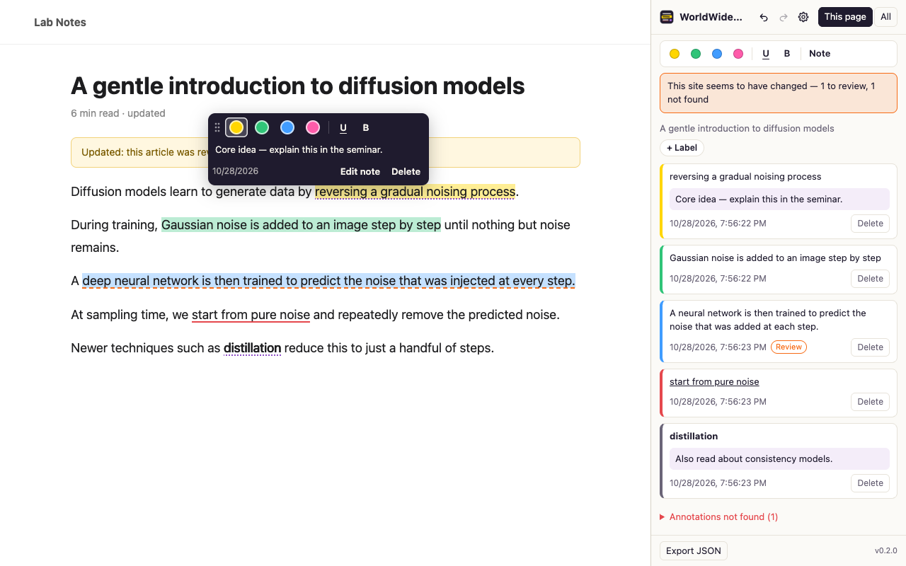

<p align="center">
  
</p>

<p align="center">
  <b>Highlights and notes for any web page — that survive when the page changes.</b><br>
  <sub>웹 어디서나 하이라이트·밑줄·볼드·메모. 사이트가 바뀌어도 주석이 살아남습니다. · <a href="#한국어">한국어</a></sub>
</p>

<p align="center">
  <a href="https://github.com/seungukkang/WWM-worldwidememo/actions/workflows/ci.yml"></a>
  
  
</p>



## Why

Web highlighters are everywhere, but they share one weakness: **when a page is edited, your annotations break.**
Articles get revised, docs get updated, papers get a v2 — and highlights silently disappear or land in the wrong place.

WWM treats *re-anchoring* as the core feature. Every annotation is stored as a [W3C Web Annotation](https://www.w3.org/TR/annotation-model/) selector (quote + surrounding context + position) and is re-found on each visit through a tiered pipeline:

| Tier | What changed | Result |
| --- | --- | --- |
| Position | Nothing | Restored instantly |
| Exact quote | Text moved, layout changed, markup added | Found again automatically |
| Fuzzy match | Text slightly edited | Relocated — marked **Review** when not certain |
| Semantic / local LLM *(planned)* | Sentence rewritten | Suggested position, **always confirmed by you** |
| — | Text removed | Kept under **Not found** — your note is never lost |

Design rule: **a wrong anchor is worse than a missing one.** When in doubt, WWM asks instead of guessing.

## Features

- Highlight (4 colors), underline, bold and notes on any selectable text
- Click an annotation to read, edit or delete its note; confirm relocated annotations in one click
- Side panel: annotations on the current page with their status, a "this site changed" summary, and all annotated pages
- Keyboard shortcuts (`Alt+Shift+H` highlight, `Alt+Shift+N` note, `Alt+Shift+U` underline) and right-click menu
- PDFs (e.g. arXiv papers): open them in the built-in WWM PDF viewer to annotate — with working links, zoom, page navigation, table of contents, download and print; PDFs you have annotated reopen there automatically
- JSON export
- English / Korean UI (follows your browser language)
- No DOM mutation: rendered with the [CSS Custom Highlight API](https://developer.mozilla.org/en-US/docs/Web/API/CSS_Custom_Highlight_API), so pages and SPAs are not broken

## Privacy

Everything stays in your browser (`chrome.storage.local`). No account, no server, no analytics.
Only the text you select (plus a short surrounding excerpt), your note, and the page URL/title are stored.
See [PRIVACY.md](PRIVACY.md).

## Install

- **Chrome Web Store** — coming soon.
- **From source** (developer mode):

  ```bash
  git clone https://github.com/seungukkang/WWM-worldwidememo.git
  cd WWM-worldwidememo
  npm install
  npm run build
  ```

  Open `chrome://extensions`, enable **Developer mode**, click **Load unpacked**, and choose the `dist/` folder.

## Development

Requires Node.js 20+.

| Command | What it does |
| --- | --- |
| `npm run dev` | Watch build into `dist/` (reload the extension and the tab after changes) |
| `npm run check` | Type-check + unit tests + build |
| `npm test` | Unit and re-anchoring regression tests (Vitest + happy-dom) |
| `npm run e2e` | Loads `dist/` into Chromium and runs a smoke test (`WWM_LANG=ko` for Korean). Needs `npx playwright install chromium` |
| `npm run release` | Checks + production build + `release/wwm-<version>.zip` |
| `npm run store-assets` | Regenerates store screenshots and promo tiles from the real extension |

```text
src/
├── core/         DOM-agnostic logic: text index, W3C selectors, tiered anchoring, repository
├── content/      Content script: selection toolbar, popover, Highlight API renderer
├── background/   Service worker: single writer for storage, messaging, badge, menus
├── sidepanel/    Side panel UI
├── shared/       Message contracts, i18n helper
└── _locales/     en, ko
tests/            Unit tests, v1→v2 page fixtures for re-anchoring, e2e smoke test
assets/           Brand, icons, store assets
scripts/          Build, icons, store assets, packaging
```

## Roadmap

- [x] Highlight / underline / bold / notes, local storage, side panel
- [x] Deterministic re-anchoring (position → exact → fuzzy) with review & "not found" states
- [x] English / Korean
- [x] PDF support (bundled pdf.js viewer)
- [ ] Full-text search across all annotations
- [ ] Markdown export for Obsidian / Notion, with links back to the exact passage
- [ ] Version history & diff view: see how the text around your note changed
- [ ] Optional sync across devices via your own Google Drive (opt-in, no WWM server)
- [ ] Semantic + on-device LLM re-anchoring for rewritten sentences (suggest only, you confirm)

## Feedback

Found a page where an annotation came back in the wrong place, or got lost? Please [open an issue](https://github.com/seungukkang/WWM-worldwidememo/issues) with the URL (if public) and what you highlighted — real-world cases become regression tests.

## License

Copyright © 2026 Seunguk Kang. **All rights reserved.** The source is public for transparency and review; no license is granted to copy, modify or redistribute it. See [LICENSE](LICENSE).

---

## 한국어

**WWM(WorldWideMemo)** 은 웹페이지 텍스트에 하이라이트(4색)·밑줄·볼드·메모를 남기고, **페이지가 수정되어도 주석을 다시 찾아 붙이는** Chrome 확장 프로그램입니다.

- 주석은 원문 인용 + 앞뒤 문맥 + 위치(W3C Web Annotation 셀렉터)로 저장되며, 방문할 때마다 **위치 → 정확한 문장 → 유사 문장(fuzzy)** 순서로 다시 찾습니다.
- 확실하지 않으면 **확인 필요**로 표시해 사용자에게 묻고, 문장이 삭제되면 **찾지 못한 주석**으로 보관해 메모를 잃지 않습니다.
- 모든 데이터는 브라우저에만 저장됩니다. 계정·서버·분석 도구가 없습니다 → [개인정보처리방침](PRIVACY.md#개인정보처리방침-한국어)
- arXiv 논문 같은 PDF도 WWM PDF 뷰어로 열어 주석을 달 수 있습니다(링크·확대/축소·페이지 이동·목차·다운로드·인쇄 지원). 주석을 단 PDF는 다음에 열 때 자동으로 WWM 뷰어로 열립니다.
- UI는 브라우저 언어에 따라 한국어/영어로 표시됩니다.

**설치(개발자 모드)**: 위 *Install* 의 명령으로 빌드한 뒤 `chrome://extensions` → 개발자 모드 → "압축해제된 확장 프로그램을 로드합니다" → `dist/` 선택.

주석이 엉뚱한 곳에 붙거나 사라지는 페이지를 발견하면 [이슈](https://github.com/seungukkang/WWM-worldwidememo/issues)로 알려 주세요. 실제 사례는 회귀 테스트로 추가됩니다.
